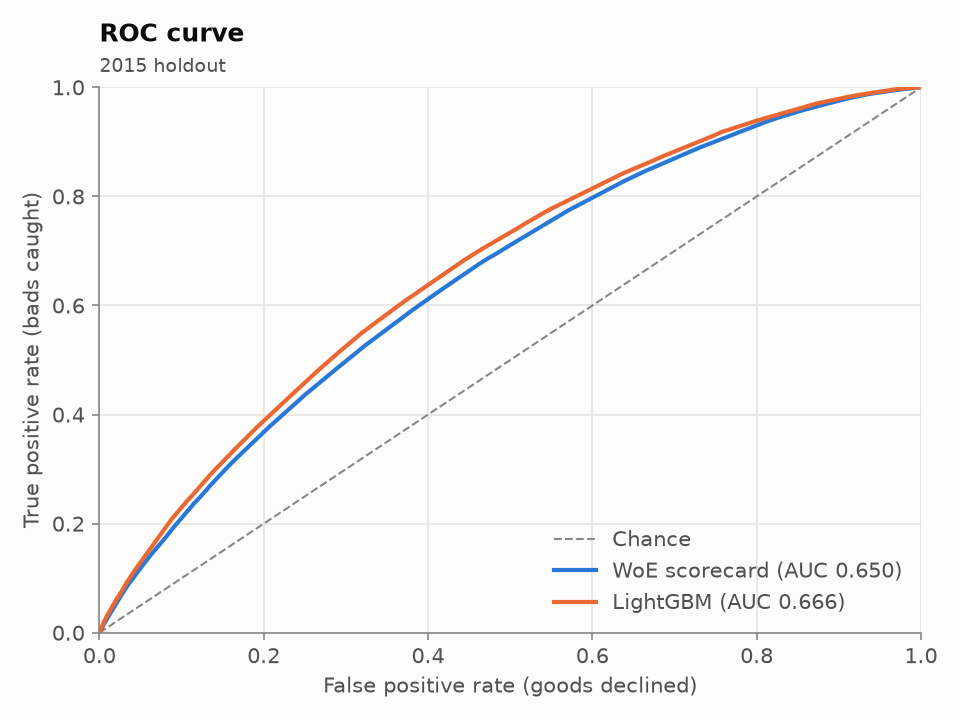
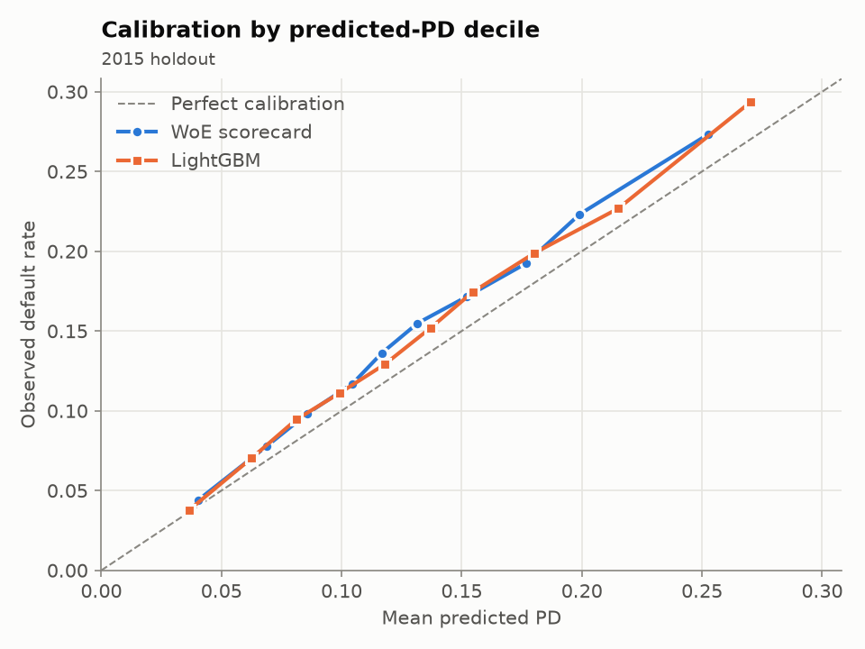
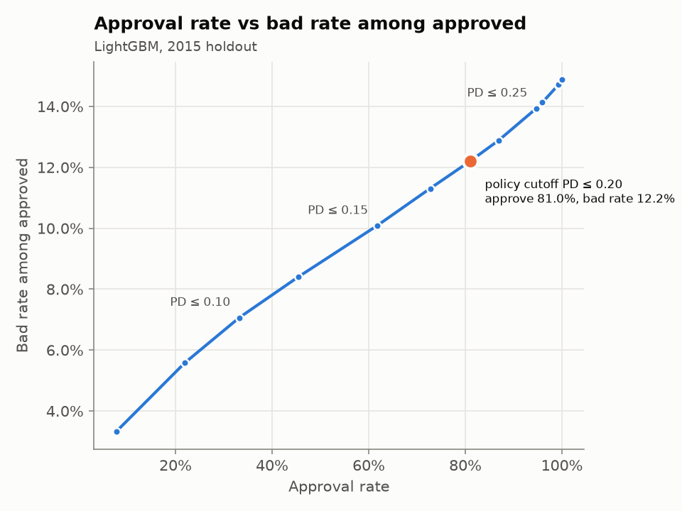
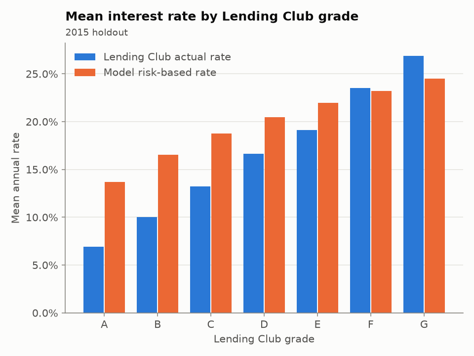

# Credit risk: PD modelling, reason codes and risk-based pricing

End-to-end probability-of-default (PD) model for unsecured consumer loans, built on Lending Club's
2007–2018Q4 accepted-loans file. It compares a hand-built weight-of-evidence (WoE) scorecard with
LightGBM on a strict out-of-time split, calibrates both, explains every decision with adverse-action
reason codes, monitors drift with PSI, runs a geographic fair-lending proxy review, and turns PD into a
risk-based interest rate that is benchmarked against Lending Club's own pricing. It ships as a
tested Python package, a CLI, and a FastAPI scoring service in Docker. On the untouched 2015 holdout
(283,026 loans) the champion LightGBM model reaches **AUC 0.666 / Gini 0.331 / KS 0.239**, against
AUC 0.650 / Gini 0.299 for the scorecard.

Every number below is copied from [`reports/metrics.json`](reports/metrics.json), produced by
`python train.py` on the real Kaggle data. Nothing is estimated by hand.

## Results (2015 out-of-time holdout, calibrated PDs)

| Model | AUC | Gini | KS | Brier | Log loss | Mean PD | Observed default rate |
|---|---|---|---|---|---|---|---|
| WoE scorecard | 0.6495 | 0.2990 | 0.2139 | 0.1225 | 0.4037 | 13.28% | 14.89% |
| **LightGBM (champion)** | **0.6655** | **0.3311** | **0.2391** | **0.1214** | **0.3991** | 13.55% | 14.89% |

| | |
|---|---|
| Population | 2,260,701 raw rows → 621,169 36-month loans issued 2007–2015 → 621,022 with a final outcome (147 still Current/Late dropped) |
| Split | train 2007–2013: 175,426 (12.63% default) · validation 2014: 162,570 (13.73%) · test 2015: 283,026 (14.89%) |
| Policy cutoff (approve if PD ≤ 0.20) | approves 80.96% of 2015 loans; bad rate 12.20% among approved vs 26.30% among declined |
| LGD (2007–2013 defaults, exposure-weighted) | 0.898 across 22,157 defaulted loans |
| Score PSI, train vs 2015 | 0.0041 (stable); every monitored feature < 0.10 |
| Fair-lending proxy (AIR ≥ 0.80) | 0 of 47 states flagged; 1 of 162 three-digit ZIPs flagged (482, AIR 0.765) |

Full tables: [model performance](reports/model_performance.md) · [scorecard](reports/scorecard.md) ·
[cutoffs](reports/cutoffs.md) · [pricing by grade](reports/pricing_by_grade.md) · [PSI](reports/psi.md) ·
[reason codes](reports/reason_codes.md) · [fairness by state](reports/fairness_addr_state.md) ·
[fairness by ZIP3](reports/fairness_zip3.md) · [model card](MODEL_CARD.md)

| ROC | Calibration |
|---|---|
|  |  |
| **Approval vs bad rate** | **Model vs Lending Club pricing** |
|  |  |

**Reading the results honestly**

- **Discrimination is modest, as expected.** Only application-time fields that Lending Club publishes
  are used, and every loan was already approved by Lending Club's own model. That truncated,
  pre-screened population is harder to separate than a through-the-door applicant pool.
- **The 2015 vintage defaults more than the model predicts.** Default rates rise by vintage (12.63% →
  13.73% → 14.89%). Isotonic calibration fitted on 2014 therefore under-predicts 2015: mean PD is
  13.55% against 14.89% observed, and the calibration chart sits above the diagonal. The ranking is
  unaffected (PSI 0.004), so this is a level shift, and the remedy is periodic recalibration on the
  latest matured vintage (see the model card's monitoring plan).
- **Lending Club's grades separate risk more steeply than this model.** Observed default runs from
  5.42% in grade A to 46.12% in grade G, while mean model PD only runs from 7.80% to 26.04%. Lending
  Club priced with full bureau data that is not in the public file. As a result, the model over-prices
  grades A–E relative to Lending Club and slightly under-prices F–G (see
  [pricing by grade](reports/pricing_by_grade.md)).
- **Model rates sit above Lending Club's in grades A–E by design.** The formula adds 9 points of
  fixed spread (4% funding + 2% operating + 3% margin) on top of expected loss. Lending Club's quoted
  rate is an investor coupon, with its own revenue earned separately through origination fees.

## Key decisions

**1. Leakage control.** Only fields known at application time become features. Post-origination
fields (`total_pymnt`, `recoveries`, `last_pymnt_d`, `out_prncp`, `last_fico_range_*`,
settlement/hardship flags, …) are never read as features. Payment and recovery columns are read only
to build the target and estimate LGD. [`tests/test_features.py`](tests/test_features.py) fails if any
leakage, benchmark or geography column reaches the feature matrix. It also checks that scrambling
those columns leaves the features bit-for-bit unchanged.

**2. Lending Club's `int_rate`, `grade` and `sub_grade` are excluded, and so is `installment`.** The
grade and rate are the output of Lending Club's own risk model. Feeding them in would mean re-learning
Lending Club's model rather than building one, and would make the pricing benchmark circular. For
the same reason, **payment-to-income was deliberately dropped** even though it was on the original
feature list. For a fixed term, `installment` is a deterministic function of loan amount and
`int_rate`, so it leaks Lending Club's price into the model. Loan-to-income captures the affordability
signal without that leak.

**3. Vintage handling: 36-month loans issued through December 2015 only.** The data ends in 2018Q4.
A 36-month loan issued in December 2015 is due by December 2018, so every loan in scope has had its
full term to either pay off or default. Only 147 of 621,169 in-scope loans were still Current or Late
and were dropped. Including later vintages would have filled the sample with loans still running,
which have had less time to default and would make recent vintages look artificially safe. 60-month
loans are excluded for the same reason: most had not matured by 2018.

**4. Out-of-time split: train 2007–2013, validate 2014, test 2015.** A random split would let the
model see the same economic conditions and underwriting policy in train and test, which overstates
performance. Splitting by issue date mirrors deployment: fit on the past, score the future. 2014 is
used for LightGBM early stopping, isotonic calibration and champion selection. 2015 is touched once,
for final reporting.

**5. Target.** Charged Off / Default = 1 and Fully Paid = 0, matched by substring. That way,
"Does not meet the credit policy. Status: Charged Off" rows are labelled correctly instead of being
silently dropped. Current, Late and In Grace Period loans have no final outcome and are removed.

**6. Scorecard built by hand.** Numerics are cut into up to 10 training-quantile bins as
right-closed intervals `(lo, hi]`, so zero-inflated counts such as public records keep their zero
bin. WoE is Laplace-smoothed: 0.5 pseudo-counts keep empty or sparse bins finite and shrink them
toward zero. Features need information value ≥ 0.02. A sign check drops any feature whose coefficient
contradicts its WoE direction, which is a symptom of collinearity. Ten features survive; FICO
(IV 0.142) and income (IV 0.087) are the strongest. Imputation medians and category levels, with
categories under 0.5% grouped into OTHER, are fitted on training data only.

**7. Calibration.** Both models are calibrated with isotonic regression on 2014. Ranking metrics
barely move, but calibrated PDs feed pricing and the approval cutoff directly, so their level matters.

**8. Champion: LightGBM, by a pre-set rule, with the scorecard kept as challenger.** The rule was
fixed in [`config.py`](src/credit_risk/config.py) before any results: LightGBM wins only if it beats
the scorecard's validation Gini by ≥ 0.03, the price of accepting a less transparent model under model
risk management. It cleared the bar narrowly: validation uplift 0.0305. Because 2014 was also
LightGBM's early-stopping set, that figure is slightly optimistic. The uplift on the untouched 2015
holdout (0.3311 − 0.2990 = 0.032) confirms it. The accuracy gain is small, and that trade-off is stated
openly:

- *For LightGBM:* its ROC curve lies on or above the scorecard's throughout, better Brier score and log loss, and
  exact per-applicant TreeSHAP reason codes, so decisions stay explainable.
- *For the scorecard:* every score is a sum of bin-table lookups that a reviewer can check by hand,
  and it is far cheaper to validate. A conservative model-risk function could reasonably choose it. That is why
  it ships in the model bundle as the challenger.

**9. LGD.** LGD = 1 − Σ(recoveries − collection fees) / Σ(funded amount − principal repaid), over
defaults issued 2007–2013 only. Exposure-weighting (a ratio of sums) keeps small, noisy balances from
dominating. Result: 0.898 on 22,157 defaults.

**10. Pricing.** rate = 4% funding + PD × LGD / 1.5 + 2% operating + 3% margin, floored at 6% and
capped at 36%. PD here is a lifetime (36-month) probability, so PD × LGD is lifetime expected loss.
Dividing by the average life, taken as half the term for an amortising loan, turns it into an annual
rate. All assumptions are in the `PricingConfig` dataclass.

## Explainability, monitoring and fairness

- **Reason codes.** The top 4 features that pushed this applicant's risk above the average
  applicant's. For LightGBM these come from TreeSHAP via `predict_proba(X, pred_contrib=True)`, with no
  `shap` dependency. For the scorecard they are coefficient × (WoE − training mean WoE). Among 2015
  applicants declined at PD > 0.20, credit score is the primary reason for 54.99%
  ([table](reports/reason_codes.md)).
- **PSI** compares train with 2015 for the score and the top 8 features: < 0.10 stable, 0.10–0.25
  investigate, > 0.25 act. Everything is stable. The largest shift is DTI at 0.0865
  ([table](reports/psi.md)).
- **Fair-lending proxy.** Lending Club publishes **no protected attributes** (race, ethnicity, sex, age),
  so this is a **geographic, redlining-style proxy review, not a fair-lending analysis**. At PD ≤ 0.20,
  adverse impact ratio = group approval rate / highest group approval rate, for groups with at least
  500 loans. No state falls below the four-fifths threshold; the lowest is HI at 0.853. One ZIP3 does:
  **482 (Detroit, MI area), AIR 0.765 on 557 loans.** Its observed default rate of 22.08% is well above
  the 14.89% average, so the gap is consistent with genuine risk differences. But Detroit is a
  majority-Black city, and a flag there is exactly what a fair-lending team would investigate further: a
  less-discriminatory-alternative search and BISG-style proxy analysis. See [MODEL_CARD.md](MODEL_CARD.md).

## Reproduce

Requires Python ≥ 3.10 (tested on 3.11) and a Kaggle API token (`~/.kaggle/access_token` or
`~/.kaggle/kaggle.json`).

```bash
python3.11 -m venv .venv && source .venv/bin/activate
pip install -r requirements-dev.txt && pip install --no-deps -e .

python scripts/download_data.py   # wordsforthewise/lending-club, ~393 MB .csv.gz into data/raw/
python train.py                   # writes reports/, models/model_bundle.joblib, mlruns/ (if MLflow installed)
pytest                            # 47 tests, all on SYNTHETIC data
```

`python train.py --pd-cutoff 0.15` changes the approval policy. `--no-mlflow` disables tracking; the
pipeline runs identically without MLflow installed. Data, models and MLflow runs are gitignored.

**Scoring API**

```bash
uvicorn api.main:app --port 8000                        # or:
docker build -t credit-risk-api . && docker run -p 8000:8000 -v "$PWD/models:/app/models:ro" credit-risk-api

curl -s localhost:8000/score -H 'Content-Type: application/json' -d '{
  "loan_amnt": 12000, "annual_inc": 65000, "emp_length_years": 4, "home_ownership": "RENT",
  "verification_status": "Verified", "purpose": "debt_consolidation", "dti": 22.5, "revol_bal": 14000,
  "revol_util": 71.0, "open_acc": 9, "total_acc": 21, "inq_last_6mths": 2, "mort_acc": 0,
  "earliest_cr_line": "2006-05-01", "fico_range_low": 675, "fico_range_high": 679,
  "application_date": "2015-06-01"}'
```

Response from the real-data model (contributions are log-odds relative to the average applicant):

```json
{"pd": 0.1739, "rate": 0.1942, "decision": "approve", "pd_cutoff": 0.2,
 "reason_codes": [{"feature": "fico_mid", "reason": "Credit score", "contribution": 0.3026},
                  {"feature": "inq_last_6mths", "reason": "Credit inquiries in the last 6 months", "contribution": 0.2344},
                  {"feature": "dti", "reason": "Debt-to-income ratio", "contribution": 0.0913},
                  {"feature": "mort_acc", "reason": "Number of mortgage accounts", "contribution": 0.0477}],
 "model": "lightgbm", "data_source": "lending_club_kaggle"}
```

Pydantic rejects invalid applications with a 422, for example FICO outside 300–850, high below low,
open accounts above total accounts, or a credit line opened after the application. `GET /health`
reports which model is loaded.

## Project layout

```
src/credit_risk/   config · data · features · models · evaluate · explain · monitoring · fairness · pricing · reports · pipeline · tracking
                   synthetic.py  - SYNTHETIC generator, tests/CI only
train.py           CLI entry point
api/main.py        FastAPI service
scripts/           download_data.py (Kaggle API)
notebooks/         01_eda.ipynb (exploration only; no modelling logic)
reports/           committed outputs of the real-data run
tests/             pytest suite (runs in GitHub Actions on synthetic data)
```

**About the synthetic data.** CI cannot download Kaggle data, so
[`synthetic.py`](src/credit_risk/synthetic.py) generates **synthetic** loans with the same raw columns
and string formats, so the real parsing code is exercised. It is used only by tests and CI. Synthetic
runs are stamped `data_source: "SYNTHETIC"`, carry a banner in every table, and write to the
gitignored `artifacts/synthetic/`, never to `reports/`.

## Limitations

- **Accepted loans only.** Lending Club's declined applicants have no outcomes, so the model is
  trained on a population that its own policy already screened. No reject inference is done, and
  performance on a through-the-door population would differ.
- **Thin feature set.** It is limited to the public file, with no full bureau attributes, bank
  transactions or income verification detail. This caps discrimination; LC's grades separate risk
  more steeply.
- **Level drift.** Calibration on 2014 under-predicts 2015 by 1.3 points of PD. Production use would
  need recalibration on the latest matured vintage.
- **36-month loans, 2007–2015 only.** 60-month loans and later vintages are out of scope.
- **Simplified economics.** There is one pooled LGD, average life is taken as half the term, PD is
  lifetime rather than annual, and prepayment, funding curves and competitive pricing are ignored.
- **No monotonic constraints** on LightGBM. LightGBM relies on TreeSHAP for explanation but is not
  guaranteed monotone in, say, FICO; neither are the scorecard's WoE bins, which are not forced monotone.
- **Fairness is geographic proxy only.** Without protected attributes, no ECOA/Reg B disparate-impact
  conclusion can be drawn. "Approval rates" are hypothetical decisions over loans LC already booked.
